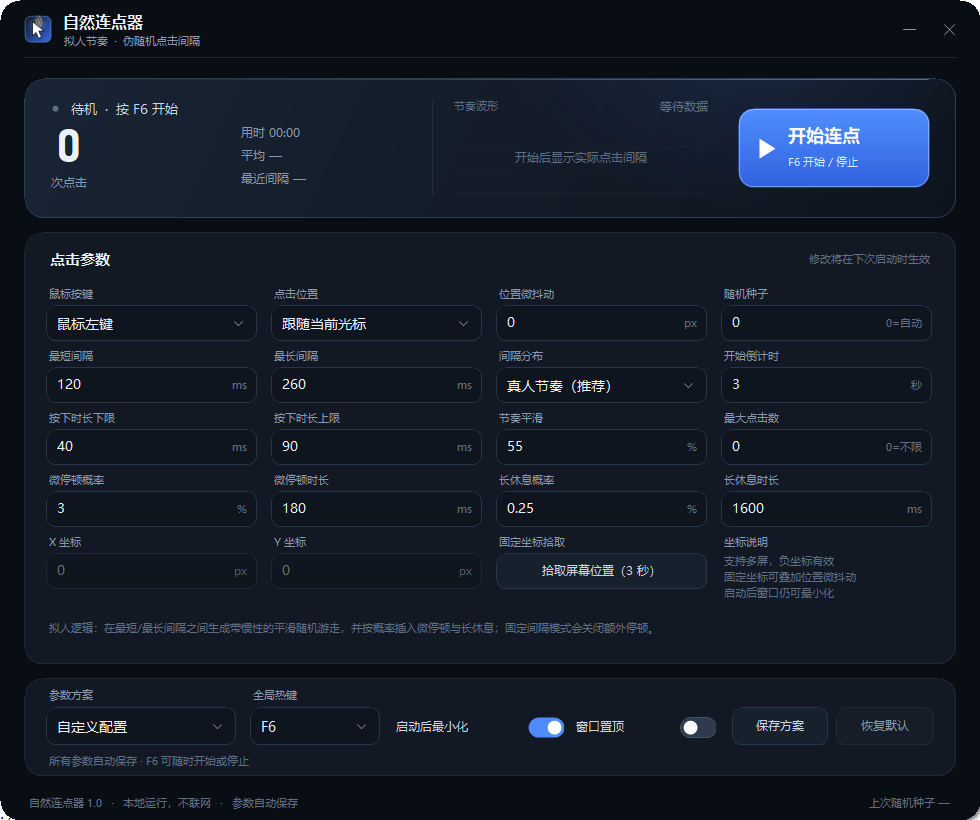

# 自然连点器 1.0

一个 Windows 桌面连点器：用伪随机数生成接近真人的点击节奏，并提供完整可调的参数面板、固定坐标、全局热键、点击统计和多套方案保存。

- 单文件绿色版，无需安装，不联网
- 支持 Windows 10 / 11（需要系统自带的 .NET Framework 4.x）
- 默认热键：`F6` 开始 / 停止



## 快速开始

1. 双击 `自然连点器.exe`。
2. 保持默认「跟随当前光标」，按 `F6` 或点击「开始连点」。
3. 程序默认会最小化，并显示 3 秒倒计时；把鼠标移到目标位置。
4. 倒计时结束后开始点击。按 `F6` 随时停止。

如果不想跟随光标，可以在「点击位置」选择「固定屏幕坐标」，再点击「拾取屏幕位置（3 秒）」，3 秒后自动记录鼠标所在坐标。

## 功能

### 拟人节奏

默认的「真人节奏」不是简单的固定随机数，而是：

- 在「最短间隔 / 最长间隔」之间生成截断正态分布；
- 用带惯性的平滑随机游走（可调「节奏平滑」）让节奏有轻微起伏，而不是每次独立乱跳；
- 以 7% 的小概率加入右侧拖尾，避免机械的等距感；
- 按概率插入「微停顿」和「长休息」，模拟换手、短暂走神；
- 每次按下的时长也在区间内随机，而不是瞬间按下/抬起。

所有随机数都由一个随机种子控制。把本次运行显示的种子填入「随机种子」，即可复现同一段节奏；填 `0` 表示每次运行自动生成。

### 参数一览

| 参数 | 默认值 | 说明 |
|---|---:|---|
| 鼠标按键 | 左键 | 左键 / 右键 / 中键 |
| 点击位置 | 跟随当前光标 | 也可固定屏幕坐标 |
| 位置微抖动 | 0 px | 仅固定坐标生效，在目标点附近随机偏移 |
| 随机种子 | 0 | 0 = 自动；填入种子可复现 |
| 最短间隔 | 120 ms | 两次点击开始之间的最短时间 |
| 最长间隔 | 260 ms | 两次点击开始之间的最长时间 |
| 间隔分布 | 真人节奏 | 真人节奏 / 均匀随机 / 固定间隔 |
| 开始倒计时 | 3 秒 | 留出移动鼠标、切换窗口的时间 |
| 按下时长下限/上限 | 40 / 90 ms | 鼠标按下保持时间 |
| 节奏平滑 | 55% | 仅真人节奏生效；越高越连贯 |
| 最大点击数 | 0 | 0 = 不限；达到后自动停止 |
| 微停顿概率 | 3% | 每次点击后按概率追加一次短停顿 |
| 微停顿时长 | 180 ms | 实际时长为 65%–135% 随机 |
| 长休息概率 | 0.25% | 按概率追加一次较长休息 |
| 长休息时长 | 1600 ms | 实际时长为 68%–132% 随机 |
| X / Y 坐标 | 0, 0 | 固定坐标模式使用；支持多屏和负坐标 |

「均匀随机」会在区间内均匀抽取间隔；「固定间隔」使用区间中点，并关闭微停顿/长休息。

### 状态与统计

- 实时点击次数、运行时长、平均频率、最近实际间隔；
- 右侧节奏波形显示最近约 56 次点击的实际间隔；
- 状态点颜色：黄色倒计时、绿色运行、红色停止/错误；
- 达到最大点击数后自动停止，并保留本次统计。

### 参数方案

- 内置「自然节奏」「轻快办公」「高速连点」「极速稳定」「慢速稳定」五套节奏；
- 选中内置方案只改变节奏参数，保留当前鼠标按键、点击位置和热键；
- 「保存方案」可以把当前完整参数保存为自定义方案；
- 所有参数自动保存，下次启动恢复。

### 全局热键与托盘

- 默认 `F6`，可在「全局热键」下拉中改成 F6–F11 或 `Ctrl+F6`–`Ctrl+F11`；
- 同一个热键开始/停止；
- 程序最小化后仍可从系统托盘打开，托盘菜单也可开始/停止；
- 窗口获得焦点时，`Esc` 也可停止。

## 安全设计

- **窗口遮挡保护**：如果点击点落在连点器自己的窗口内，程序会立即停止，而不是反复点自己的界面。
- **默认最小化**：开始后自动最小化，避免点击落到界面上；倒计时结束前可以移动鼠标。
- **收尾释放**：停止、达到次数、运行异常或关闭程序时，都会确保发送鼠标抬起，避免鼠标卡在按下状态。
- **关闭即停**：点击窗口右上角关闭时，会先停止点击线程并释放鼠标，再退出。
- **权限提示**：如果目标程序以管理员身份运行，Windows 会拦截普通权限程序的模拟输入。此时需要同样以管理员身份运行本程序。

## 配置文件

正常情况：

```text
%APPDATA%\NaturalClicker\settings.xml
%APPDATA%\NaturalClicker\presets\*.xml
```

如果该目录不可写（例如在受限沙箱或只读目录中运行），会自动改用 exe 同目录的：

```text
NaturalClicker-Data\settings.xml
```

也可以用环境变量 `NATURALCLICKER_DATA_DIR` 指定数据目录。删除上述目录即可恢复默认设置。

## 从源码构建

项目只用 .NET Framework 自带的 C# 编译器，不需要 NuGet 或额外依赖。

```powershell
powershell -NoProfile -ExecutionPolicy Bypass -File .\build.ps1
```

输出：

```text
dist\自然连点器.exe
```

源码结构：

```text
src/AppSettings.cs      参数模型与内置方案
src/ClickEngine.cs      点击线程、拟人节奏、统计
src/Native.cs           Win32 输入、全局热键、屏幕坐标
src/Controls.cs         自绘控件
src/Dialogs.cs          倒计时悬浮条、保存方案对话框
src/MainForm.cs         主界面与状态机
src/Program.cs          入口、单实例
src/Theme.cs            配色、字体、绘制辅助
src/SettingsStore.cs    设置与方案持久化
```

## 常见问题

**点击没有反应？**
目标程序可能忽略了模拟输入，或它以管理员身份运行。尝试以相同权限运行本程序；部分游戏使用原始输入或反作弊机制，无法保证兼容。

**F6 没反应？**
F6 可能被其他程序占用。换一个全局热键，或直接点击「开始连点」按钮。热键注册失败时界面会给出提示。

**实际点击速度比设置慢？**
如果「按下时长」接近或超过「最短间隔」，实际节奏会受按下时长限制。适当降低按下时长，或提高最短间隔。

**Windows 提示未知发布者？**
这是未签名的本地小工具，Windows SmartScreen 可能提示。确认文件来源可信后，可选择「更多信息 → 仍要运行」。

**点击次数和目标程序记录不一致？**
先确认目标窗口没有被其他窗口遮挡；某些程序会过滤合成点击，或只接受特定权限级别的输入。

---

请仅在你有权自动化的软件和场景中使用本工具，并遵守目标软件的使用规则。
